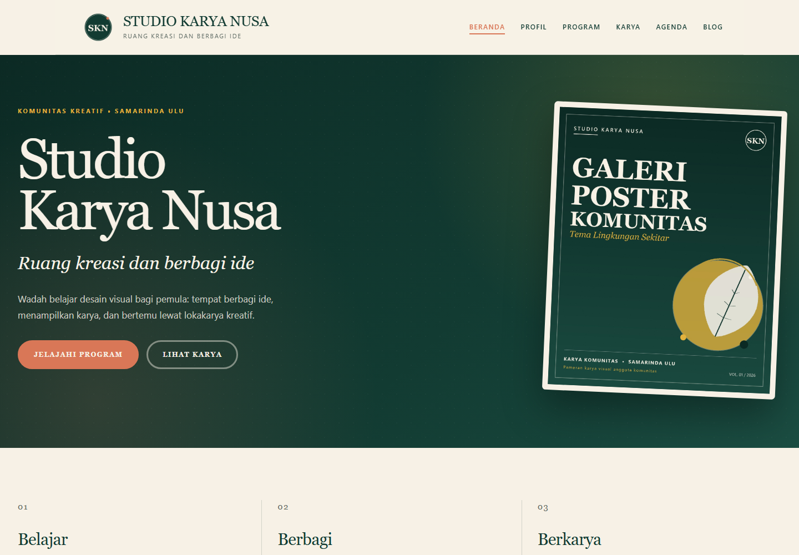
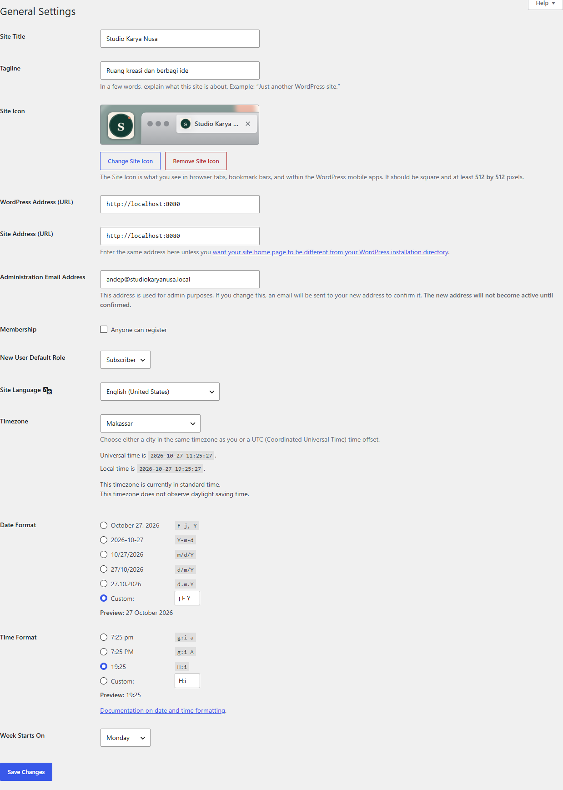
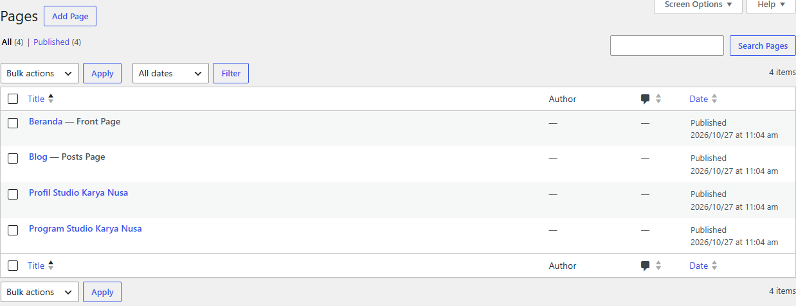
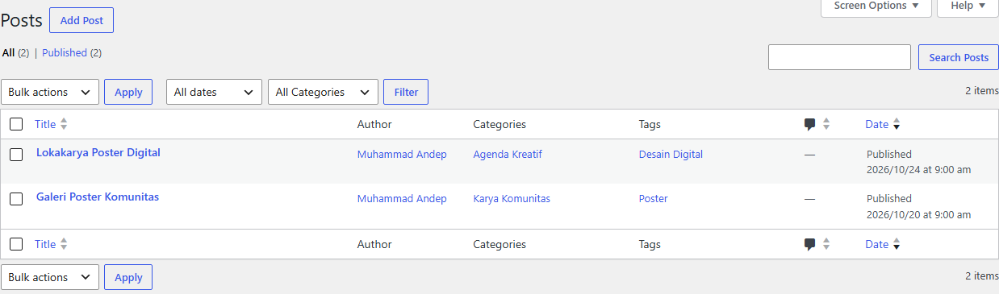
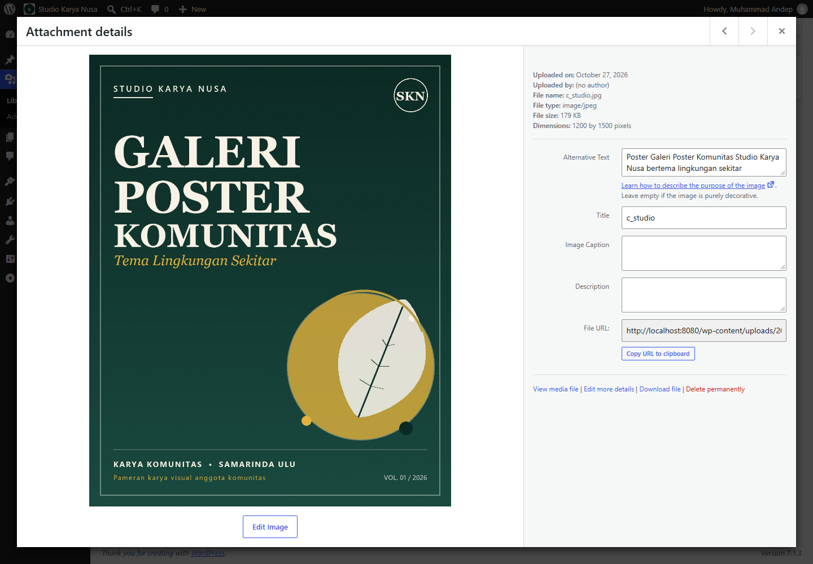
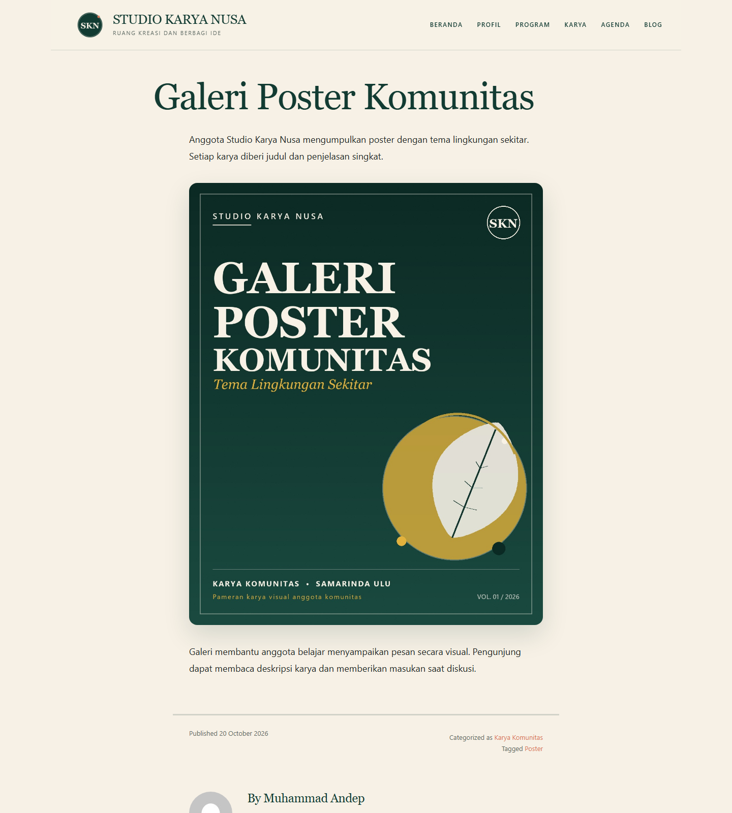
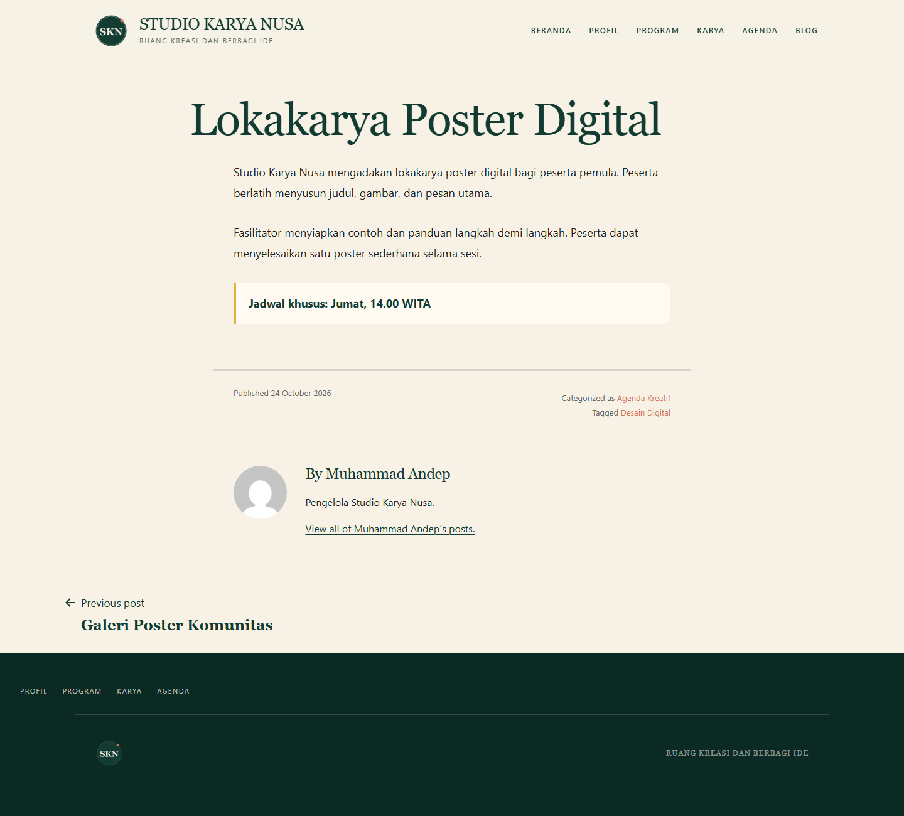
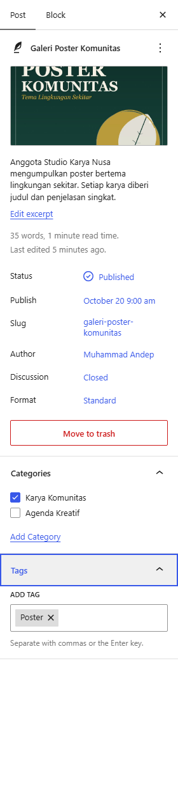
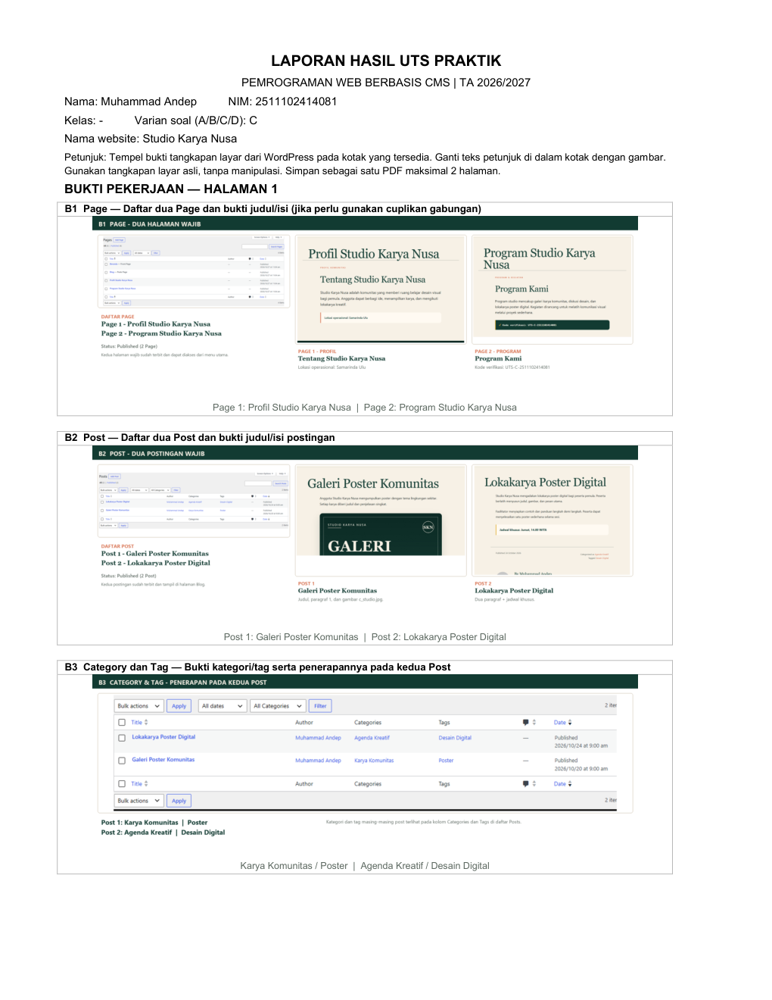
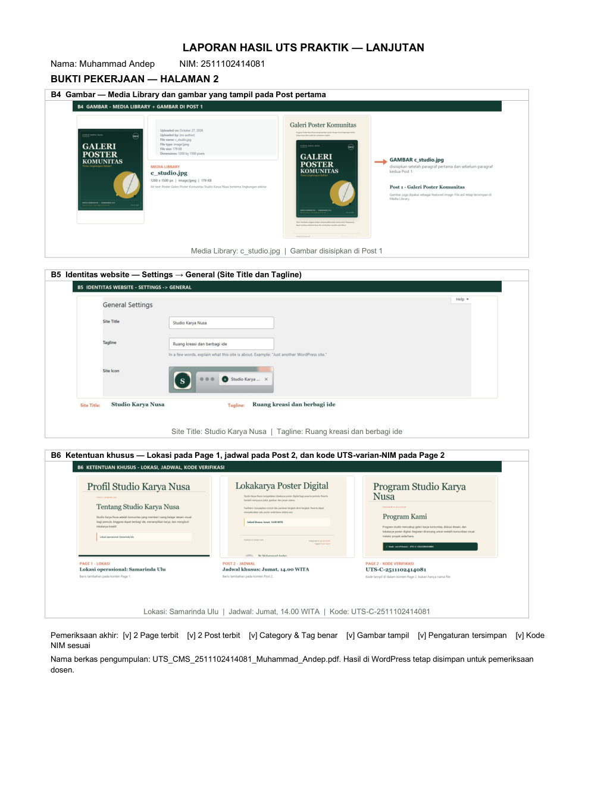

# Studio Karya Nusa

**UTS Praktik Pemrograman Web Berbasis CMS — Varian C**

Website komunitas kreatif fiktif **Studio Karya Nusa** yang dibuat dengan WordPress di localhost. Proyek ini memenuhi brief UTS: 2 halaman, 2 postingan, kategori & tag, gambar di postingan, nama/deskripsi website, serta laporan bukti 2 halaman sesuai template kampus.



---

## Identitas

| Item | Nilai |
|---|---|
| Nama | **Muhammad Andep** |
| NIM | **2511102414081** |
| Varian soal | **C — Studio Karya Nusa** |
| Mata kuliah | Pemrograman Web Berbasis CMS (UNI2053) |
| Semester | 3 / TA 2026/2027 |
| Nama website | **Studio Karya Nusa** |
| Tagline | **Ruang kreasi dan berbagi ide** |

**Kode verifikasi:** `UTS-C-2511102414081`

---

## Panduan untuk teman

Baca **[Panduan Transfer & Demo](docs/PANDUAN-TRANSFER-DAN-DEMO.md)** untuk:
- cara menyerahkan website ke laptop teman,
- script demo ke dosen,
- cara membuat post baru langkah demi langkah,
- cara mengedit Page/Post, kategori/tag, menu, homepage,
- backup, restore, dan troubleshooting.

Panduan ini juga ikut di dalam ZIP portable (`docs/PANDUAN-TRANSFER-DAN-DEMO.md`).

## Preview

- **Front-end:** <http://localhost:8080>
- **Admin:** <http://localhost:8080/wp-admin>
- **Username:** `admin`
- **Password:** `StudioKaryaNusa2026!`

> Website ini berjalan di **localhost** dan tidak untuk di-hosting publik. Database memakai MariaDB portable di dalam folder proyek.

[Lihat homepage lengkap](docs/screenshots/home-full.png)

---

## Cara menjalankan

### Paling mudah — portable

1. Extract `Studio-Karya-Nusa-Portable.zip` ke folder sederhana, misalnya `C:\StudioKaryaNusa`.
2. Buka folder hasil extract (`AndepWordPress`), lalu double-click **`MULAI.bat`**.
3. Tunggu beberapa detik; browser otomatis membuka <http://localhost:8080>.
4. Untuk mematikan, double-click **`MATIKAN.bat`**.

> ZIP portable tidak disertakan di repo GitHub karena berisi binary PHP + MariaDB (172 MB). Minta file ZIP-nya dari pemilik proyek. Repo GitHub berisi source, konten, backup SQL/WXR, dan laporan UTS.

Tidak perlu install XAMPP, Laragon, PHP, atau MySQL. Semua sudah ada di dalam folder portable.

### Pindah ke laptop teman

1. Matikan website di laptop asal dengan `MATIKAN.bat`.
2. Copy **seluruh folder** (atau extract ZIP portable) ke laptop Windows 11 tujuan.
3. Letakkan di path sederhana, misalnya `C:\StudioKaryaNusa` (hindari path yang terlalu panjang).
4. Buka folder `AndepWordPress`, lalu double-click `MULAI.bat`.
5. Alamat tetap <http://localhost:8080>.

> Jika Windows Defender/SmartScreen bertanya, pilih **Allow / Run anyway**. Script hanya menjalankan PHP dan MariaDB lokal dari folder proyek.

---

## Yang sudah dibuat

### B1 — Dua Page

| Page | Isi wajib |
|---|---|
| **Profil Studio Karya Nusa** | Heading **Tentang Studio Karya Nusa**, paragraf profil, dan **Lokasi operasional: Samarinda Ulu** |
| **Program Studio Karya Nusa** | Heading **Program Kami**, paragraf program, dan **Kode verifikasi: UTS-C-2511102414081** |

### B2 — Dua Post

| Post | Isi wajib |
|---|---|
| **Galeri Poster Komunitas** | 2 paragraf sesuai brief + gambar `c_studio.jpg` di antara paragraf 1 dan 2 |
| **Lokakarya Poster Digital** | 2 paragraf + **Jadwal khusus: Jumat, 14.00 WITA** |

### B3 — Category & Tag

| Post | Category | Tag |
|---|---|---|
| Galeri Poster Komunitas | **Karya Komunitas** | **Poster** |
| Lokakarya Poster Digital | **Agenda Kreatif** | **Desain Digital** |

### B4 — Gambar

- `c_studio.jpg` diunggah ke **Media Library** (1200 × 1500 px, alt text terisi).
- Disisipkan di **Post 1** setelah paragraf pertama dan sebelum paragraf kedua.
- Juga dipakai sebagai **featured image** Post 1.
- Post 2 memakai featured image pendukung `lokakarya.jpg`.

### B5 — Identitas Website

- **Site Title:** `Studio Karya Nusa`
- **Tagline:** `Ruang kreasi dan berbagi ide`
- Logo, site icon, menu navigasi, homepage kreatif, dan custom CSS.

### B6 — Ketentuan Khusus

- **Lokasi** di Page 1: `Lokasi operasional: Samarinda Ulu`
- **Jadwal** di Post 2: `Jadwal khusus: Jumat, 14.00 WITA`
- **Kode verifikasi** di Page 2: `UTS-C-2511102414081`

---

## Bukti screenshot

| Settings → General | Pages |
|---|---|
|  |  |

| Posts + Category/Tag | Media Library |
|---|---|
|  |  |

| Post 1 | Post 2 |
|---|---|
|  |  |

| Editor Post 1 — kategori/tag/featured image |
|---|
|  |

---

## Laporan UTS

Laporan mengikuti **Template Laporan UTS Praktik WordPress** dari dosen (2 halaman, kotak bukti B1–B6):

| Dokumen | File |
|---|---|
| PDF siap kumpul | [`bukti/UTS_CMS_2511102414081_Muhammad_Andep.pdf`](bukti/UTS_CMS_2511102414081_Muhammad_Andep.pdf) |
| DOCX editable | [`bukti/UTS_CMS_2511102414081_Muhammad_Andep.docx`](bukti/UTS_CMS_2511102414081_Muhammad_Andep.docx) |

| Halaman 1 | Halaman 2 |
|---|---|
|  |  |

> Kolom **Kelas** di laporan diisi `-` karena informasi kelas belum diberikan. Jika perlu, buka DOCX, isi kelas, lalu export ulang ke PDF.

---

## Struktur folder

```text
AndepWordPress/
├── MULAI.bat                 # nyalakan website portable
├── MATIKAN.bat               # matikan website
├── BACKUP.bat                # backup SQL + WXR
├── router.php                # router PHP built-in server
├── assets/                   # poster, logo, custom.css, generator gambar
├── content/                  # block markup Page/Post/Homepage
├── scripts/                  # start/stop/backup/set-css
├── public/                   # WordPress (core di-ignore Git)
│   ├── wp-config.php
│   └── wp-content/uploads/   # gambar Media Library
├── backup/
│   ├── database.sql          # dump database lengkap
│   └── studio-karya-nusa-wxr.xml
├── bukti/
│   ├── UTS_CMS_...pdf        # laporan final 2 halaman
│   ├── UTS_CMS_...docx       # versi editable
│   └── report/B1–B6.png      # komposit bukti
├── docs/screenshots/         # screenshot untuk README
├── bin/                      # PHP + MariaDB portable (tidak di-commit)
├── data/                     # database MariaDB (tidak di-commit)
├── logs/                     # log runtime (tidak di-commit)
└── runtime/                  # PID, screenshot kerja (tidak di-commit)
```

`bin/`, `data/`, `logs/`, dan `runtime/` tidak masuk Git karena berisi binary/runtime besar. Salinan lengkap ada di **ZIP portable**.

---

## Backup & restore

### Backup

Jalankan `BACKUP.bat` saat website menyala. File yang dihasilkan:

- `backup/database.sql` — dump MariaDB lengkap (opsi, konten, kategori, tag, media, custom CSS).
- `backup/studio-karya-nusa-wxr.xml` — export WordPress (konten, page, post, kategori, tag, attachment).

### Restore ke WordPress lain

1. Di WordPress tujuan: **Tools → Import → WordPress**.
2. Install importer jika diminta.
3. Upload `studio-karya-nusa-wxr.xml`.
4. Centang **Download and import file attachments**.
5. Assign author ke user yang ada.

> WXR tidak membawa Site Title, Tagline, menu, dan custom CSS. Atur ulang lewat **Settings → General**, **Appearance → Menus**, dan **Customize → Additional CSS** (isi dari `assets/custom.css`).

### Restore ke folder portable

Database sudah ikut di dalam folder `data/`. Jika database hilang, `MULAI.bat` akan mencoba membuat ulang dari `backup/database.sql`.

---

## Teknologi

| Komponen | Versi |
|---|---|
| WordPress | 7.1.3 |
| PHP | 8.3.36 (NTS, x64) |
| MariaDB | 11.4.9 |
| Theme | Twenty Twenty-One 2.9 (default WordPress) |
| Plugin | Tidak ada |
| Web server | PHP built-in server + `router.php` |
| Desain | Custom CSS di `assets/custom.css` |

Semua gambar (`c_studio.jpg`, `lokakarya.jpg`, logo, site icon) dibuat khusus untuk proyek ini menggunakan Python/Pillow. Tidak mengambil gambar dari internet.

---

## Catatan

- Website hanya untuk **localhost**; jangan diekspos ke internet.
- Jangan hapus folder instalasi sampai verifikasi dosen selesai.
- `WP_HTTP_BLOCK_EXTERNAL` diaktifkan agar WordPress tidak melakukan loopback HTTP ke server single-thread (mencegah hang).
- Jika port `8080` atau `3307` dipakai aplikasi lain, matikan aplikasi tersebut atau hubungi pemilik proyek.
- Jika laporan perlu diubah, edit DOCX di `bukti/`, lalu export ke PDF dan pastikan tetap **maksimal 2 halaman**.

---

## Kredit

Dibuat untuk UTS Praktik **Pemrograman Web Berbasis CMS**, Universitas Muhammadiyah Kalimantan Timur, TA 2026/2027.

- WordPress — GPL
- Twenty Twenty-One — GPL
- Poster dan aset visual — dibuat khusus untuk proyek ini
